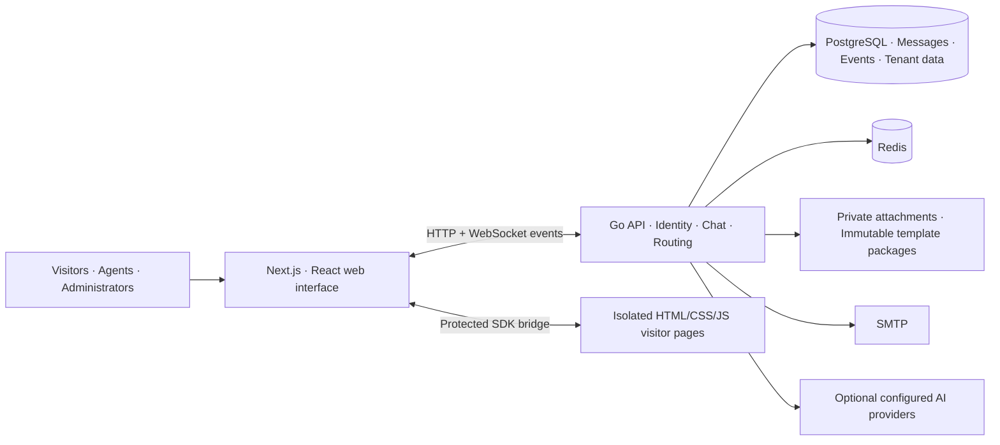

<!-- 文件作用说明：作为英文优先的GoodChat项目首页，介绍产品、真实压缩截图、文档、部署入口与作者联系方式。 -->


# GoodChat — Self-Hosted Live Chat & Customer Support Platform

[English](README.md) · [简体中文](README.zh-CN.md) · [Official website](https://goodchat.58it.cn) · [Feature guide](docs/en/features.md) · [Getting started](docs/en/getting-started.md)

GoodChat is a **self-hosted, multi-tenant live chat and customer service SaaS** built with **Go, PostgreSQL, Redis, Next.js, React and TypeScript**. It brings an agent workspace, customer profiles, conversation routing, service automation and reporting together with **seven responsive visitor chat templates**, a visual editor and an AI-assisted template design workflow.

The project is designed for teams that want to manage customer conversations and control the pages their visitors see. Use the standard chat page, choose an industry template, or create a private HTML/CSS/JavaScript design while keeping messaging on the platform's protected chat core.

**Website:** [goodchat.58it.cn](https://goodchat.58it.cn)

Screenshots below show the actual **Chinese-language interface with demonstration and acceptance data**. The English documentation does not imply a fully translated application UI. Screenshot files are compressed WebP images; template images are rendered application pages, not concept mockups.

## A quick tour

- Handle conversations in a browser-based customer support dashboard.
- Separate tenant workspaces, administrative roles and reception eligibility.
- Route consultations through groups, skills, queues and weighted allocation.
- Keep customer profiles, notes, tags and conversation history together.
- Reuse welcome messages, quick replies and keyword-based service rules.
- Customize a visitor page visually or edit its static source files.
- Publish deliberately, bind consultation links and preserve existing private copies.
- Review service activity, export records and monitor the running application.


*A local preview of the product website and its service and account entry points.*

## Documentation

| Guide | What you will find |
| --- | --- |
| [Getting started](docs/en/getting-started.md) | Dependencies, configuration, local startup and deployment considerations. |
| [Complete feature guide](docs/en/features.md) | A screenshot-led tour of reception, customers, automation, reporting and administration. |
| [Visitor templates](docs/en/templates.md) | Seven industry styles, desktop/mobile examples and the editing workflow. |
| [中文项目首页](README.zh-CN.md) | The full project introduction in Simplified Chinese. |
| [Source conventions](AGENTS.md) | Repository scope and development conventions. |

## Live chat built around the agent's work

The workspace combines a conversation inbox, message history and customer context. Agents can inspect unread activity, move between consultations, use prepared replies and maintain available or busy reception states. Claiming, accepting, rejecting, transferring and closing conversations follow the configured routing rules.

Text, images, files and audio are handled through authorized messaging and attachment APIs. Quoted replies, read receipts, typing indicators and time-limited withdrawal help both sides follow the conversation.


*One workspace for the conversation and the information needed to continue it.*

### Messaging recovery, not just a connected socket

GoodChat persists messages through HTTP requests with stable client message IDs. WebSocket notifications announce updates, while durable event backfill restores missed changes after reconnection. The client distinguishes connection and recovery states, deduplicates messages and preserves IDs when a send needs a controlled retry.

A sleeping computer or frozen browser tab can still disconnect. The recovery workflow is designed to reconnect and synchronize; it does not promise an uninterrupted socket under every browser or network condition.

## Seven visitor chat templates worth making your own

The visitor page is part of the service experience. GoodChat includes seven distinct industry directions, with layouts for both desktop and mobile browsers.

| Industry | Design direction |
| --- | --- |
| Finance | Powder blue and gold, advisor photography and a private-consultation layout. |
| Commerce | Persimmon orange, packaging photography and approachable after-sales support. |
| Education | Warm paper tones, ink green, books and learning prompts. |
| Healthcare services | Porcelain white and teal, consultation-room photography and clear service guidance. |
| Property | Warm neutrals, editorial typography and interior photography. |
| Business services | Black-and-white typography, concrete interiors and focused consultation. |
| Gaming | Charcoal and acid lime, esports equipment and a dark conversation interface. |


*Seven rendered mobile pages, with independent visual styles and the same protected messaging capabilities.*

The template library displays real page previews. Tenants can create private copies, compare designs and keep their own versions when the platform library changes.


*Desktop and mobile layouts adapt the composition while keeping the conversation and input usable.*

A template package contains **HTML, CSS, JavaScript and static assets**. Download it, change it and import a new version without a second frontend compilation step. The official SDK continues to handle messages, attachments, history, consultation options, offline messages and evaluations.

[Explore the full visitor-template gallery →](docs/en/templates.md)

## Point-and-click editing with source access

Select an element in the rendered preview to change its text, CSS classes and styles. Open the HTML/CSS source, add local page interactions in JavaScript, or upload and replace images. Image handling checks format, dimensions and size and applies compression when needed.

The ordinary editor keeps the official chat SDK and package contract read-only. This lets a design change independently from the connection, authorization and messaging infrastructure.


*Inspect an element, adjust its appearance, refresh the preview and save a new draft.*

Source changes are saved as new immutable packages. Tenant page edits remain drafts until explicitly published. Consultation links can follow a published page or remain on a fixed release. Deletion checks references before reclaiming unused files, and an unbound link keeps the built-in visitor page.

## AI-assisted template design

Administrators can describe a page, upload reference images, continue a saved design conversation or remix an existing template. A side-by-side preview uses simulated messages so the page can be reviewed before publication.

Text/vision and image-generation models can be configured separately. Tenant and platform settings remain distinct, provider keys are stored encrypted, and generated file JSON must pass the template contract before it becomes a package. Generated code cannot replace the protected chat scripts.

Platform administrators maintain versioned system prompts and official core scripts through separate foundation settings. Existing packages retain their script snapshots.


*A new design conversation before any template has been generated.*

The current AI feature is a **template design assistant**, not an autonomous visitor-support chatbot. Provider credentials, model access and usage limits must be configured for actual calls.

## Customer context, reporting and daily operations

### Customer profiles that support the next conversation

Manage contact information, tags, categories, custom fields, visit history and internal notes. Search and filtering help the team find the right record; authorized note attachments preserve supporting context.


*Customer service context remains within the authorized tenant workspace.*

### Reports connected to recorded service activity

Tenant reports show activity by date, agent and entry channel, including conversation and message totals, waiting time and first-response measures. Member and link statistics provide more focused views. Administrators can export filtered CSV records or use asynchronous jobs for larger exports.


*Template-preview messages are local demonstrations and do not count as real customer consultations.*

### Monitoring with an explicit measurement scope

Platform monitoring includes measured application/control-group resources, database pool health, live connection counts and reception-capacity summaries. Capacity estimates require a configured measurement baseline.


*Resource and connection monitoring with a manually entered 100-user demo baseline.*

## Feature map

| Area | Implemented capabilities |
| --- | --- |
| Conversations | Inbox, unread activity, assignment actions, transfers, history, quoted replies and read receipts. |
| Media | Authorized image/file/audio handling, previews, downloads and browser-dependent voice recording. |
| Routing | Manual reception, round robin, persistent weighted round robin, skills, capacity and queues. |
| Customers | Profiles, search, tags, categories, custom fields, visit history, notes and blocking. |
| Service automation | Shared/personal quick replies, welcome rules, keyword rules and notification preferences. |
| Feedback | Offline messages with attachments, follow-up lists, optional email notifications and satisfaction evaluations. |
| Analytics | Tenant, member and link statistics; filtered CSV and asynchronous export jobs. |
| Visitor pages | Seven responsive industry templates, static packages, visual/source editing and ZIP import/export. |
| AI design | Administrator conversations, reference images, template remixing and separate model settings. |
| Identity | Email verification, password/code login, invitations, roles, sessions and ownership transfer. |
| Platform operations | Tenant management, plan definitions, seat entitlements, upgrade requests and manual activation. |
| Integration | Signed visitor-entry callbacks with delivery records and retry controls. |

See the [complete feature guide](docs/en/features.md) for additional screenshots and role-specific details.

## Roles and service boundaries

| Role | Main responsibilities |
| --- | --- |
| Visitor | Chat, send attachments, leave messages and evaluate service. |
| Agent | Handle consultations, use personal service tools and manage reception state. |
| Tenant owner/admin | Configure the team, links, routing, templates, service rules and reports. |
| Platform admin | Manage tenants, public templates, plans, platform AI and monitoring. |

Administrative permissions and reception eligibility are separate. Optional capabilities also depend on the applicable plan entitlements.

## Architecture



PostgreSQL stores durable conversation and event data. Tenant-scoped authorization and business-table row-level security separate workspaces. Redis is required by the runtime; SMTP enables email verification and notification workflows, while AI providers are optional. Visitor templates run on an isolated origin and communicate with their trusted host through the fixed SDK.

## Getting started

The implementation documented here is on the `dev` branch:

```bash
git clone --branch dev https://github.com/hhh0078/GoodChat.git
cd GoodChat
```

Follow the [getting-started guide](docs/en/getting-started.md) to prepare PostgreSQL, Redis, the private environment and database roles. The current Compose file provides the GoodChat application; it does not provision a fresh database or Redis service for you.

After the guide has prepared `.local/docker.env` and the required services:

```bash
docker compose --env-file .local/docker.env build goodchat
docker compose --env-file .local/docker.env up -d --no-build goodchat
curl --fail http://127.0.0.1:13000/healthz
```

The local web entry is `http://127.0.0.1:13000`. Production setup needs its own HTTPS, public origin, isolated template domain, persistent storage and backup configuration.

## Frequently asked questions

### Is GoodChat an AI chatbot?

Its current AI assistant helps administrators create and revise templates. The live-chat workflow connects visitors and service agents; a general autonomous answer bot is not part of the described feature set.

### Can I edit a template without rebuilding the application?

Yes. Visitor template packages use static HTML/CSS/JavaScript and assets. Editing, ZIP import/export and publication are supported; changes to the application itself still require its normal build and deployment workflow.

### Can I use GoodChat for several teams or tenants?

Yes. It has tenant workspaces, member roles, routing groups and administrative boundaries. Reception eligibility is configured separately from administrative permissions.

### Are payments, social channels and native apps included?

Plan definitions and manual upgrade activation are implemented. Online payment gateways, native desktop/mobile clients and social-channel connectors are not implied by this web application.

### Does it already provide a distributed real-time cluster?

The current real-time push implementation is single-instance. Horizontal scaling requires shared event distribution; durable HTTP event backfill remains the recovery path.

### What are the licensing and commercial-use terms?

Please contact the author for licensing, commercial use and customization terms.

## Project topics

GoodChat covers self-hosted live chat, multi-tenant customer support software, a Go customer service backend and a React agent dashboard. The repository also includes WebSocket message recovery, customer profiles, service analytics, static HTML chat templates, a visual CSS editor and AI-assisted visitor-page design.

## Author and contact

| | |
| --- | --- |
| Author | **邓云川 · Deng Yunchuan** |
| GitHub | [@hhh0078](https://github.com/hhh0078) |
| Website | [goodchat.58it.cn](https://goodchat.58it.cn) |
| Phone / WeChat | **17607080935** |
| Email | [1224299352@qq.com](mailto:1224299352@qq.com) |

For issues and feature requests, use the repository's [issue tracker](https://github.com/hhh0078/GoodChat/issues). For deployment, business cooperation or customization, contact the author above.

[Getting started](docs/en/getting-started.md) · [Full feature guide](docs/en/features.md) · [Visitor templates](docs/en/templates.md) · [简体中文](README.zh-CN.md)
