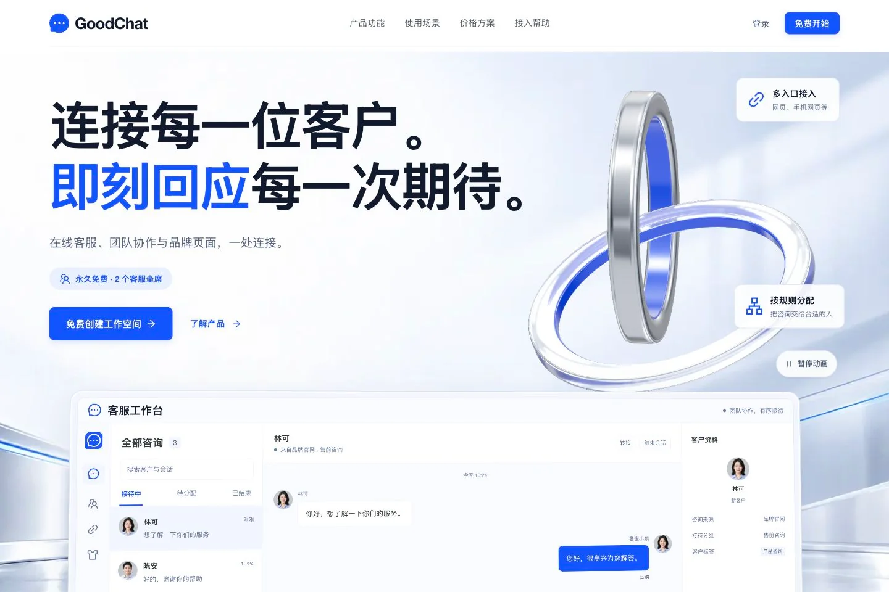
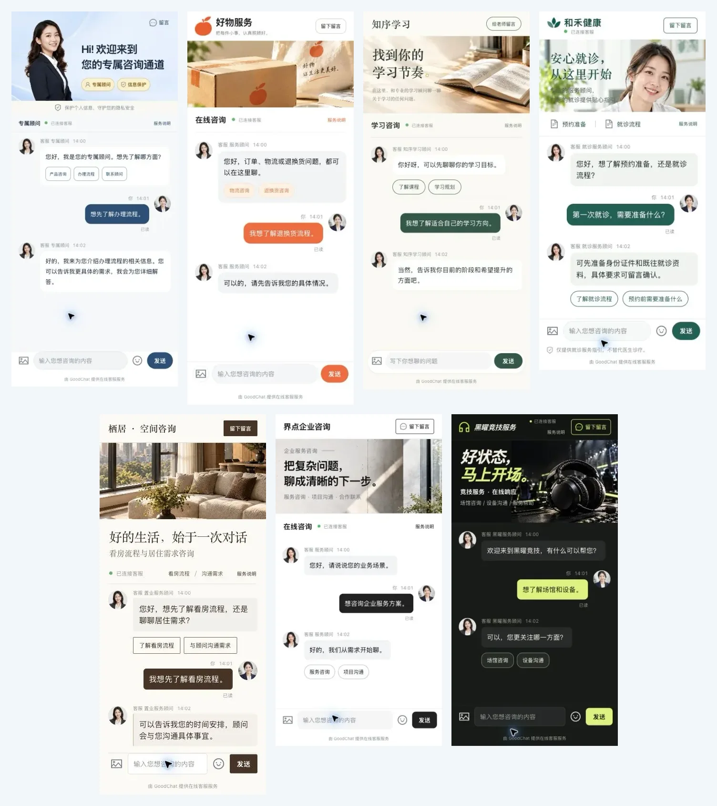
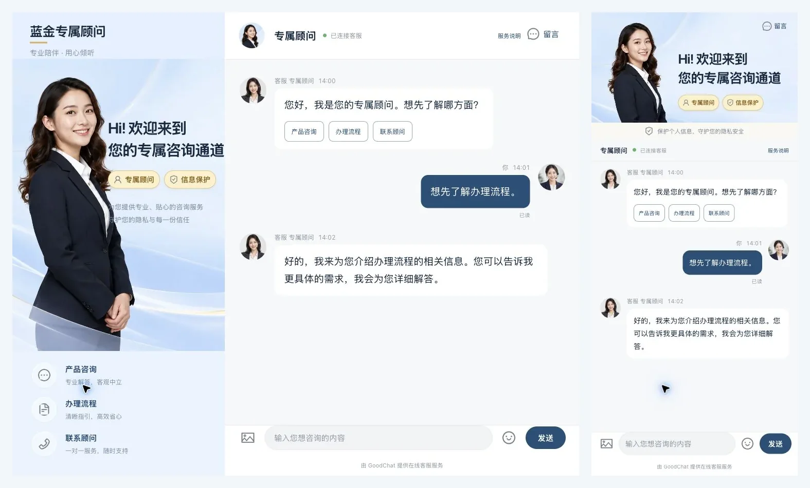
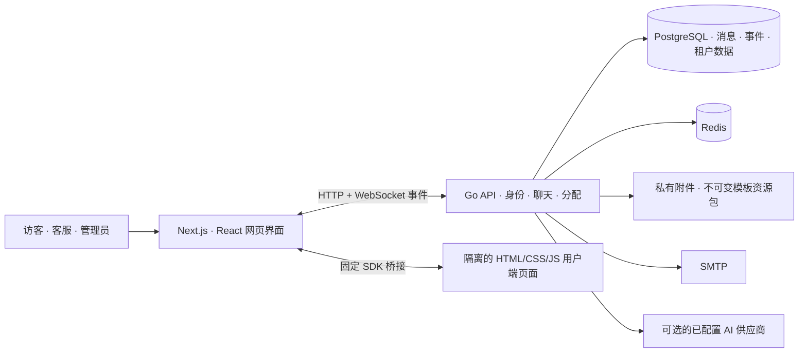

<!-- 文件作用说明：作为GoodChat中文项目首页，介绍产品、真实压缩截图、文档、部署入口与作者联系方式。 -->


# GoodChat — 私有化部署的多租户在线客服系统与客户服务平台

[English](README.md) · [简体中文](README.zh-CN.md) · [官方网站](https://goodchat.58it.cn) · [功能导览](docs/zh-CN/features.md) · [开始使用](docs/zh-CN/getting-started.md)

GoodChat 是一套支持**私有化部署的多租户在线客服与客户服务 SaaS**，采用 **Go、PostgreSQL、Redis、Next.js、React 和 TypeScript**。项目将客服工作台、客户资料、会话分配、回复运营和统计报表，与**七套响应式用户端模板**、可视化编辑器和 AI 辅助模板设计流程连接在一起。

它面向既需要统一处理客户咨询，又希望掌握用户端页面外观的服务团队。可以使用默认聊天页、选择行业模板，也可以制作自己的 HTML/CSS/JavaScript 私有设计，同时继续使用平台受保护的聊天核心。

**官方网站：** [goodchat.58it.cn](https://goodchat.58it.cn)

下方截图来自**实际运行的中文界面，使用演示与验收数据**。英文文档不代表应用界面已经完整国际化。截图均为压缩后的 WebP 图片；模板展示的是实际渲染页面，不是设计概念图。

## 先看项目能做什么

- 在浏览器客服工作台集中处理客户咨询。
- 分开管理租户空间、管理角色与接待资格。
- 使用业务组、技能、队列与加权分配安排接待。
- 将客户资料、备注、标签与聊天历史放在一起。
- 复用欢迎语、快捷回复与关键词服务规则。
- 可视化定制用户端页面，也可以修改静态源文件。
- 明确发布、绑定咨询链接，并保留已有私有副本。
- 查看服务活动、导出记录并监控运行中的应用。



*本地运行的官网首页，介绍产品并展示服务与账号入口。*

## 文档导航

| 文档 | 内容 |
| --- | --- |
| [开始使用](docs/zh-CN/getting-started.md) | 依赖、配置、本机启动与部署注意事项。 |
| [完整功能导览](docs/zh-CN/features.md) | 接待、客户、运营、统计与平台管理的截图介绍。 |
| [用户端模板](docs/zh-CN/templates.md) | 七个行业风格、电脑/手机实例与编辑流程。 |
| [English README](README.md) | 英文项目介绍。 |
| [开发约定](AGENTS.md) | 仓库范围与开发规范。 |

## 围绕接待工作的客服工作台

工作台将咨询列表、聊天记录与客户上下文结合在一起。客服可以查看未读动态、切换咨询、使用预设话术，并维护可接待或忙碌状态。会话认领、接受、拒绝、转接与关闭遵循当前分配规则。

文字、图片、文件与音频通过授权的消息和附件接口处理。引用回复、已读状态、输入提示与限时撤回帮助双方跟进沟通。


*围绕当前会话，集中查看继续服务所需的信息。*

### 既关注连接，也关注消息恢复

GoodChat 通过 HTTP 请求持久化消息，并使用稳定的客户端消息编号。WebSocket 负责及时通知，持久事件补拉负责在重连后恢复遗漏的更新。客户端区分连接与恢复状态，对消息去重，并在发送结果未确认时保留原编号进行受控重试。

电脑睡眠或浏览器冻结仍可能造成断连。产品提供重连与同步恢复流程，不承诺在所有浏览器和网络条件下始终不断线。

## 七套值得定制的用户端客服模板

用户端页面也是服务体验的一部分。GoodChat 内置七种独立行业设计，分别适配电脑与手机浏览器。

| 行业 | 设计方向 |
| --- | --- |
| 金融 | 浅蓝与金色、顾问摄影和专属咨询布局。 |
| 电商 | 朱橙品牌、包裹摄影与轻快的售后服务。 |
| 教育 | 暖纸白、墨绿、书本与学习问题边注。 |
| 医疗服务 | 白青配色、诊室摄影与清楚的就诊服务说明。 |
| 房产 | 暖砂留白、编辑式衬线标题与室内空间摄影。 |
| 企业服务 | 黑白字体、混凝土空间与聚焦需求的会客布局。 |
| 电竞 | 黑曜与青柠、电竞设备摄影与深色聊天界面。 |



*七种真实渲染的手机页面，拥有独立视觉风格与相同的受保护聊天能力。*

模板库直接展示真实页面预览。租户可以比较设计、创建私有副本，并在平台模板库变化时继续保留自己的版本。



*电脑与手机采用合适的构图，同时保留可用的聊天与输入区域。*

模板包由 **HTML、CSS、JavaScript 和静态资源**组成。下载修改后可以重新导入，不需要二次前端编译。消息、附件、历史、咨询选项、留言与评价继续由官方 SDK 处理。

[查看完整用户端模板图集 →](docs/zh-CN/templates.md)

## 点选元素编辑，也能查看源文件

在真实预览中选中元素，即可修改文字、CSS 类名和样式。也可以打开 HTML/CSS 源码、添加本地 JavaScript 页面交互，或上传替换图片。图片处理会检查格式、像素与体积，仅在需要时压缩。

普通编辑器中的官方聊天 SDK 与资源包合约保持只读，让视觉改动与连接、授权、消息基础能力分别维护。


*选中元素，调整外观，更新预览，再保存成新的草稿。*

源文件改动保存为新的不可变资源包，租户页面修改在明确发布前保持为草稿。咨询链接可以跟随已发布页面，也可以固定到某个发布版本。删除前会检查引用，再回收不再使用的文件；未绑定额外模板的入口继续使用内置用户端页面。

## AI 辅助模板设计

管理员可以描述页面、上传参考图片、继续保存的设计对话，或对已有模板进行二次创作。右侧预览使用模拟消息，方便发布前审查。

文字/视觉模型与生图模型可以分别配置。租户与平台设置相互独立，供应商密钥加密保存，生成文件 JSON 需要通过模板合约检查才能转换为资源包。生成内容不能替换受保护的聊天脚本。

平台管理员通过独立的基础设置维护系统提示词和官方核心脚本版本，已有资源包继续保留原脚本快照。


*尚未生成模板的新设计对话。*

当前 AI 功能是**模板设计助手**，不是自动回答访客问题的客服机器人。实际调用需要配置供应商凭证、模型权限和使用额度。

## 客户上下文、服务统计与日常运营

### 为下一次咨询保留客户背景

维护联系资料、标签、分类、自定义字段、访问记录和内部备注。搜索与筛选帮助团队查找客户，授权备注附件用于保留相关资料。


*客户服务上下文保持在授权的租户空间内。*

### 统计来自已经记录的服务活动

租户报表按日期、客服和入口渠道汇总活动，提供咨询量、消息量、等待时间和首响等指标。成员与链接统计提供更具体的视角，管理员还可以导出筛选后的 CSV，或为较大数据创建异步导出任务。


*模板预览消息只在本地演示，不计为真实客户咨询。*

### 说明测量范围的运行监控

平台监控提供实测的应用或控制组资源、数据库连接池健康、实时连接数与接待容量汇总。容量估算需要配置测量基线。


*资源与连接监控，图中 100 人为手录演示基线。*

## 功能一览

| 模块 | 已实现能力 |
| --- | --- |
| 会话 | 咨询列表、未读动态、分配动作、转接、历史、引用与已读。 |
| 媒体 | 授权图片/文件/音频处理、预览、下载与浏览器支持的录音。 |
| 分配 | 手动接待、轮询、持久加权轮询、技能、容量与排队。 |
| 客户 | 档案、搜索、标签、分类、自定义字段、访问记录、备注与拉黑。 |
| 回复运营 | 公共/个人快捷回复、欢迎规则、关键词规则与通知偏好。 |
| 反馈 | 带附件留言、跟进列表、可选邮件提醒与满意度评价。 |
| 统计 | 租户、成员与链接统计，筛选 CSV 与异步导出任务。 |
| 用户端页面 | 七套行业模板、静态资源包、可视化/源码编辑与 ZIP 导入导出。 |
| AI 设计 | 管理员对话、参考图片、模板二创与独立模型配置。 |
| 身份 | 邮箱验证、密码/验证码登录、邀请、角色、会话与所有权转移。 |
| 平台运营 | 租户管理、套餐、席位权益、升级申请与人工开通。 |
| 集成 | 带签名的访客进入回调、投递记录与重试控制。 |

在[完整功能导览](docs/zh-CN/features.md)中查看更多截图与角色说明。

## 角色与服务边界

| 角色 | 主要职责 |
| --- | --- |
| 访客 | 聊天、发送附件、留言与评价服务。 |
| 客服 | 接待咨询、使用个人服务工具并维护接待状态。 |
| 租户所有者/管理员 | 配置团队、链接、分配、模板、运营规则与统计。 |
| 平台管理员 | 管理租户、公共模板、套餐、平台 AI 与监控。 |

管理权限与接待资格分别设置，可选功能同时受当前套餐权益约束。

## 技术架构



PostgreSQL 保存持久消息与事件。租户范围授权和业务表行级安全将工作空间隔离。运行时需要 Redis，邮箱验证与通知流程需要 SMTP，AI 供应商按需配置。用户端模板在独立来源运行，通过固定 SDK 与可信宿主页面通信。

## 开始使用

本页介绍的最新实现位于 `dev` 分支：

```bash
git clone --branch dev https://github.com/hhh0078/GoodChat.git
cd GoodChat
```

先按[开始使用文档](docs/zh-CN/getting-started.md)准备 PostgreSQL、Redis、私有环境与数据库角色。当前 Compose 文件只提供 GoodChat 应用，不会自动为新环境创建数据库和 Redis 服务。

文档中的 `.local/docker.env` 和依赖服务准备好后：

```bash
docker compose --env-file .local/docker.env build goodchat
docker compose --env-file .local/docker.env up -d --no-build goodchat
curl --fail http://127.0.0.1:13000/healthz
```

本机网页入口为 `http://127.0.0.1:13000`。生产部署需要自己的 HTTPS、公开来源、隔离模板域名、持久存储与备份配置。

## 常见问题

### GoodChat 是 AI 客服机器人吗？

当前 AI 助手用于帮助管理员创建和修改模板。在线聊天流程连接访客与客服，本页介绍的交付范围不包含通用自动问答机器人。

### 修改用户端模板需要重新构建整个应用吗？

不需要。用户端模板使用 HTML/CSS/JavaScript 与静态资源，支持编辑、ZIP 导入导出与发布；修改应用本身仍需要按正常流程构建和部署。

### 能服务多个团队或租户吗？

可以。系统提供租户空间、成员角色、分配组与管理边界，接待资格与管理权限分别配置。

### 已包含支付、社交渠道和原生客户端吗？

套餐定义与人工开通已经实现。当前网页应用不代表已提供在线支付网关、原生电脑/手机客户端或社交渠道连接器。

### 已经支持分布式实时集群吗？

当前实时推送为单实例实现，横向扩容需要共享事件分发；持久 HTTP 事件补拉继续作为恢复途径。

### 如何了解许可和商业使用方式？

请联系作者确认许可、商业使用与定制条款。

## 项目主题

GoodChat 涵盖私有化部署在线客服、多租户客户服务系统、Go 客服后端与 React 客服工作台。仓库还包含 WebSocket 消息恢复、客户资料、服务统计、HTML 用户端聊天模板、可视化 CSS 编辑与 AI 辅助页面设计。

## 作者与联系方式

| | |
| --- | --- |
| 作者 | **邓云川 · Deng Yunchuan** |
| GitHub | [@hhh0078](https://github.com/hhh0078) |
| 官网 | [goodchat.58it.cn](https://goodchat.58it.cn) |
| 电话 / 微信 | **17607080935** |
| 邮箱 | [1224299352@qq.com](mailto:1224299352@qq.com) |

问题反馈与功能建议可以提交到仓库的 [Issues](https://github.com/hhh0078/GoodChat/issues)。部署、商务合作与定制需求，请通过上方方式联系作者。

[开始使用](docs/zh-CN/getting-started.md) · [完整功能导览](docs/zh-CN/features.md) · [用户端模板](docs/zh-CN/templates.md) · [English](README.md)
