<!-- 文件作用说明：以英文介绍GoodChat已实现的客服、模板、管理与运维功能，并连接真实压缩界面截图。 -->
# GoodChat Features — Live Chat, Customer Support & Customizable Templates

**English** · [简体中文](../zh-CN/features.md) · [Project home](../../README.md) · [Official website](https://goodchat.58it.cn)

GoodChat is a self-hosted, multi-tenant live chat and customer support platform for teams that want to manage conversations and control their visitor-facing pages. Its Go backend and React workspace connect reception, customer profiles, service automation, reporting and customizable HTML chat templates in one application.

This guide describes features implemented in the repository. The screenshots show the actual **Chinese-language interface with demonstration and acceptance data**; English documentation does not imply that the application interface is fully translated. Screenshots are compressed WebP files. The industry-template gallery uses rendered application pages rather than design mockups.

## Who uses GoodChat?

| Role | Typical responsibilities |
| --- | --- |
| Visitor | Open a consultation link, chat with a service team, send attachments, leave a message and evaluate a conversation. |
| Agent | Handle assigned conversations, use personal replies, consult customer context and maintain reception availability. |
| Tenant owner or administrator | Invite members, configure links and routing, manage customers and service rules, customize templates and review reports. |
| Platform administrator | Manage tenants, published templates, plan definitions, manual upgrade activation, platform AI configuration and server monitoring. |

Administrative permissions and eligibility to receive chats are separate: an administrator does not automatically have to occupy a reception role.

## 1. Live chat and the agent workspace

The customer support dashboard keeps the conversation inbox, message history and customer context together. Agents can move between consultations, inspect unread activity and control their available or busy state. Conversation actions cover claiming, accepting, rejecting, transferring and closing a consultation according to the configured reception rules.

Messages support text, images, files and audio, with authorized previews or downloads. Quoted replies, read receipts, typing indicators and time-limited withdrawal make ongoing conversations easier to follow. Browser recording and playback depend on the capabilities and permissions of the browser in use.

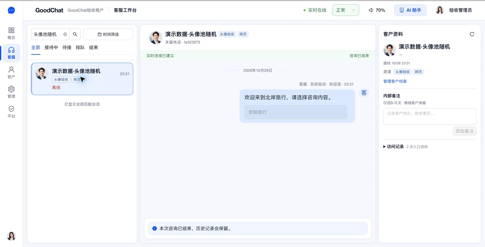

### Recovery when the network changes

Messages are persisted through HTTP requests with stable client message IDs. WebSocket notifications tell the browser that updates are available; durable event backfill restores missed updates after a connection interruption. The interface distinguishes connecting, recovering and connected states rather than treating an opened socket as completed synchronization.

Unconfirmed sends retain their original IDs for a controlled retry. The browser does not silently create a new successful message when the result is uncertain. Browser freezing or system sleep can still interrupt a connection; recovery is a reconnect-and-sync workflow, not a promise that a socket never disconnects.

## 2. Customer profiles and service context

Customer records give agents useful context without requiring a separate sales CRM. Teams can organize contacts with tags, tag categories, customer categories and custom fields, then search and filter the records. Visit history and internal notes help preserve context between consultations; notes may include authorized attachments.

Tenant administrators can block a contact when necessary. Customer display names and phone fields are profile data, not substitutes for the visitor's authenticated session.

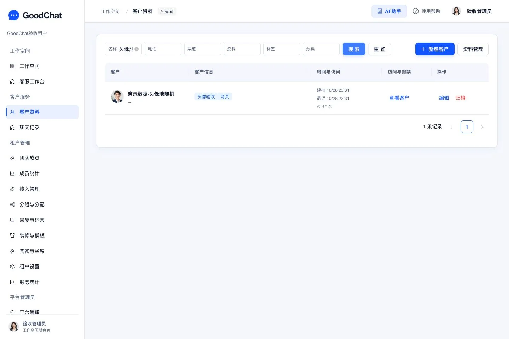

## 3. Team members, invitations and permissions

Owners and administrators manage members and invitations, reception eligibility, groups and seats. Email verification supports account registration and invitation acceptance; password and email-code login, password reset, session management and ownership transfer are included.

Personal service tools remain owned by the current agent. Team-level rules are managed through the administrator's controls, while shared rules can be displayed as read-only in an agent's personal view.

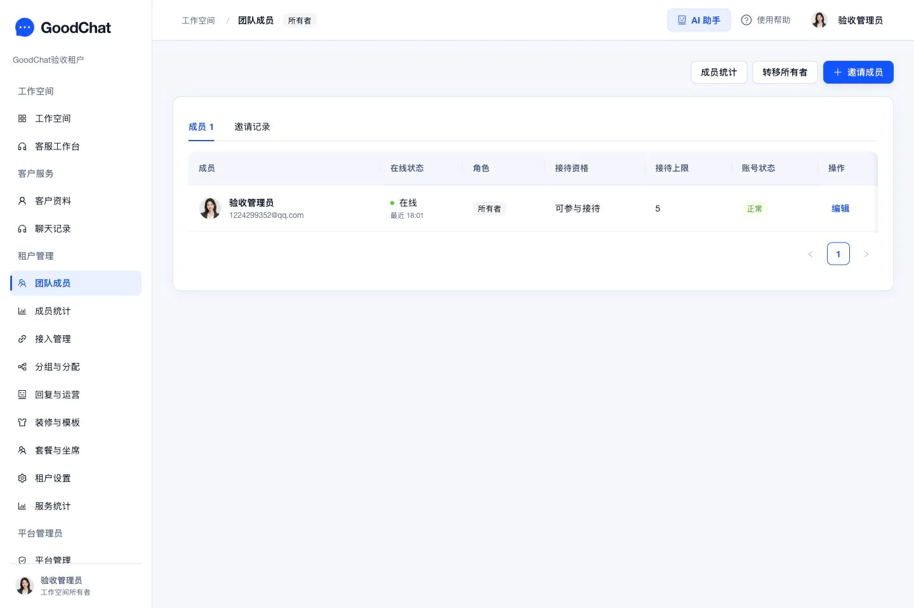

## 4. Consultation links and reception routing

Create multiple visitor entry links for different campaigns, teams or service scenarios. A link can carry source information and configured visitor fields, select reception behavior, and bind a published visitor-page template. A link without a template binding continues to use the built-in visitor page.

Links are a practical way to give different business lines their own entry points while keeping conversation handling in the same tenant workspace.

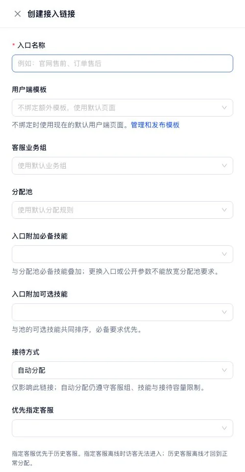

### Route each consultation to an eligible agent

Routing configuration supports manual reception, round robin and persistent weighted round robin. Groups and routing pools define who can receive a consultation; required and optional skills refine candidate selection. Capacity and availability checks are evaluated against the current reception state, including when a queued consultation is retried.

Historical-agent preference can help a returning visitor reach a previous service agent when that agent is still eligible. Transfer and queue behavior remain part of the same conversation lifecycle.

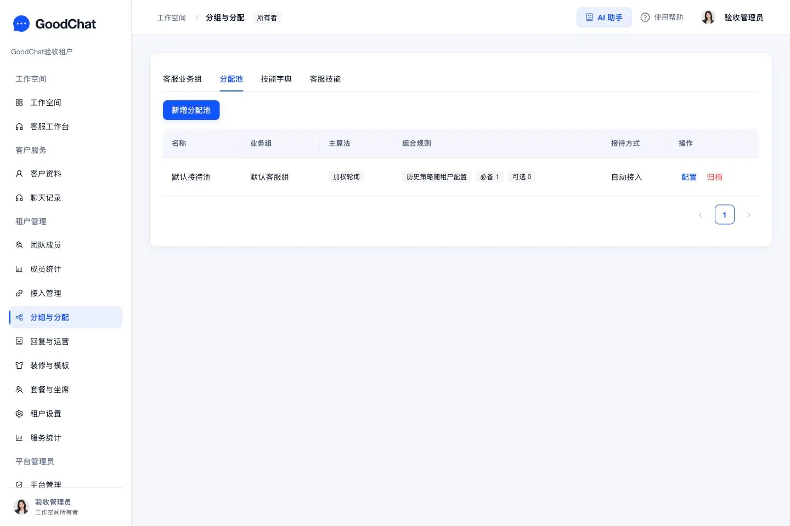

## 5. Quick replies, welcome messages and keyword rules

Shared and personal quick replies reduce repetitive typing. Rich replies can include text, images or selectable consultation options. Agents can maintain their own content while using approved team material.

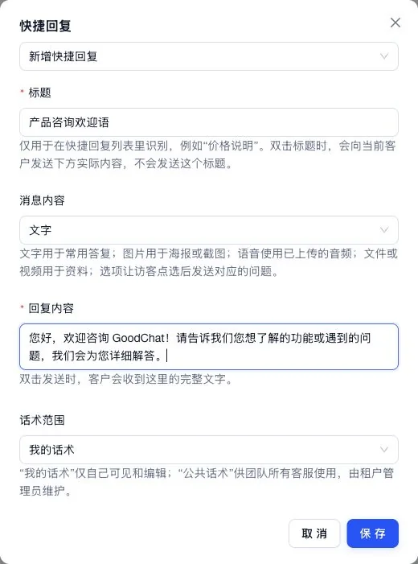

Welcome rules support scoped service scenarios and configurable content. Administrators can maintain team rules, while individual agents manage their own welcome settings. Previewing a rule helps distinguish its appearance from a message actually delivered to a visitor.

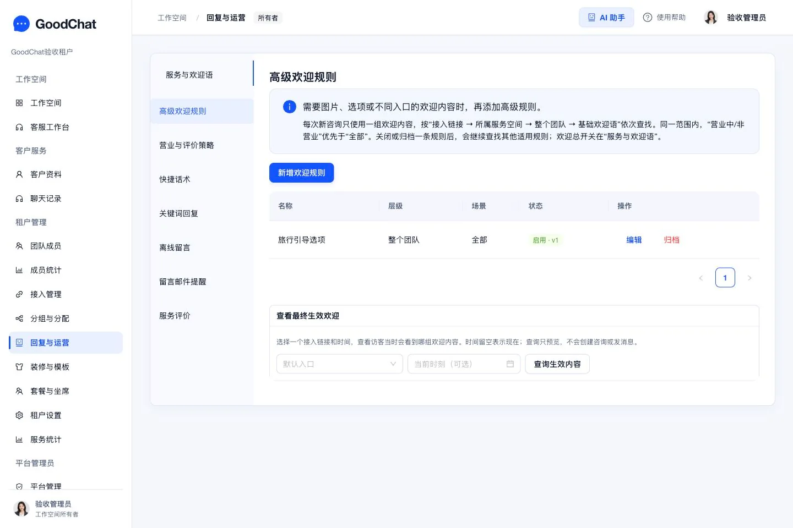

Keyword rules provide another controlled way to send prepared service content. These are configured rules, not a general-purpose AI answer engine.

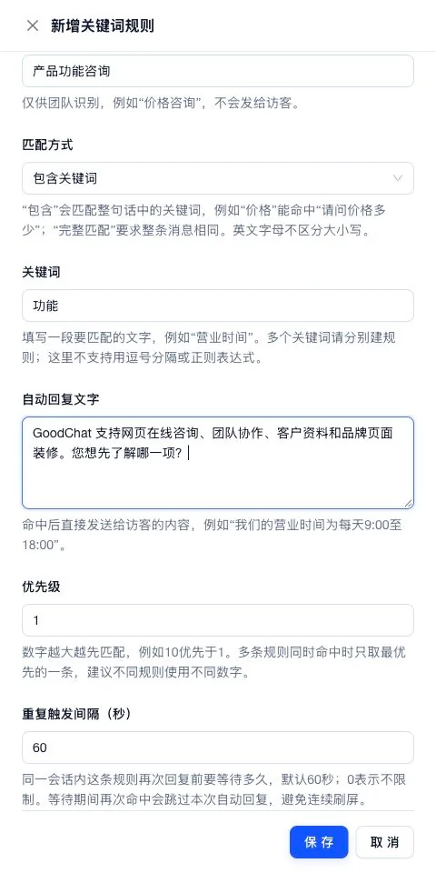

## 6. Offline messages and customer feedback

Visitors can leave an offline message with contact information and permitted attachments. The tenant workspace provides a follow-up list so the team can track and process these messages. Optional email notifications have delivery records and retry controls; enabling them requires working SMTP configuration.

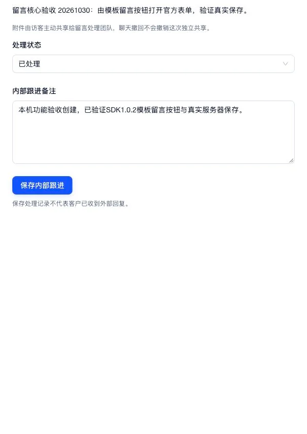

Conversation evaluations support satisfaction feedback, configurable timing and recorded revision history. Administrators can review feedback in the context of the service conversation.

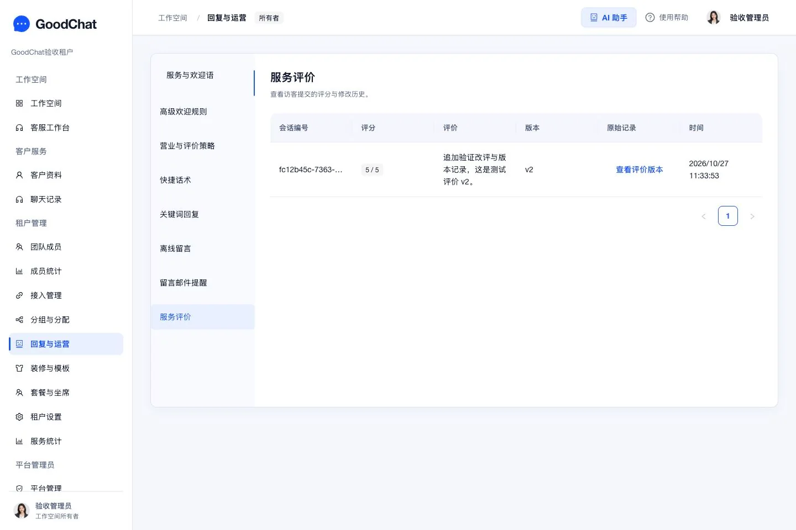

## 7. Conversation history, reports and exports

The history view helps teams find previous conversations through the available filters. History visibility is subject to the current tenant, member permissions and configured reception scope; a person cannot gain access simply by supplying a conversation ID.

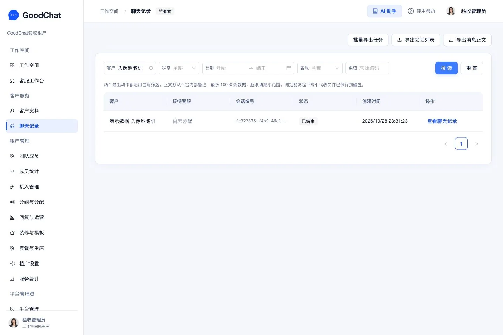

Tenant reports summarize real service activity by date, agent and entry channel. Available measures include visitor and conversation totals, queue or active states, message counts, waiting time and first-response measures. Date ranges follow the tenant's configured time zone.

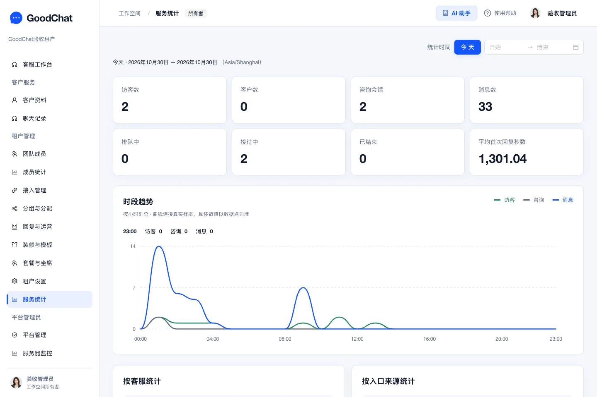

Member statistics and link statistics help administrators inspect service distribution and entry-point performance. Statistics describe recorded activity; they do not turn a simulated template preview into a real customer consultation.

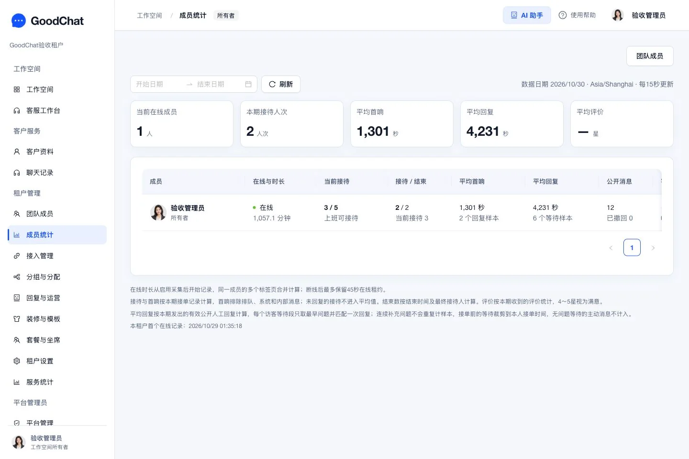

Authorized administrators can export filtered conversation data as CSV. Larger exports use cancellable asynchronous jobs with progress, retention and storage limits. Export downloads recheck permissions, and withdrawn content is accounted for when a previously generated result would otherwise expose stale text.

## 8. Seven responsive visitor chat templates

Visitor-facing templates are a central part of GoodChat. The built-in industry collection includes seven distinct directions:

| Industry | Visual direction |
| --- | --- |
| Finance | Powder blue and gold, advisor photography and a private-consultation layout. |
| Commerce | Persimmon orange, packaging photography and an approachable after-sales conversation. |
| Education | Warm paper tones, ink green, book photography and learning prompts. |
| Healthcare services | Porcelain white and teal, consultation-room photography and clear service guidance. |
| Property | Warm neutrals, editorial typography and interior photography. |
| Business services | Black-and-white typography, concrete interiors and a focused consultation space. |
| Gaming | Charcoal and acid lime, esports equipment photography and a dark conversation interface. |

Each template has desktop and mobile layouts. The library cards show the actual rendered pages and open a larger preview, so a tenant can compare styles before creating a private copy.

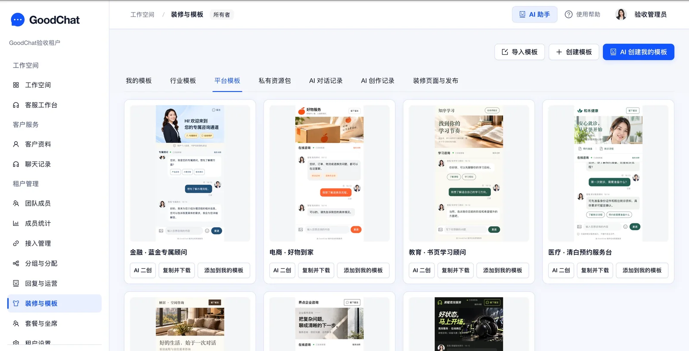

The exported package consists of **HTML, CSS, JavaScript and static assets**. A tenant can download it, modify it and import a new version without a second frontend compilation step. Platform-owned scripts continue to handle messages, attachments, history, consultation options, offline messages and evaluations.

See the [visitor template gallery and editing workflow](templates.md) for larger mobile and desktop screenshots of all seven industries.

## 9. Visual editing, source files and controlled publishing

The built-in visual editor lets an administrator select an element in the rendered preview, then change its text, CSS classes and styles. Source views support HTML, CSS and controlled local JavaScript. Images can be uploaded or replaced; format, dimensions and size are checked, with compression applied when needed.

Extra HTML and local JavaScript can implement page-specific interactions such as a service-information dialog. The protected chat SDK, message UI and package contract remain read-only in ordinary template editing, keeping visual customization separate from messaging infrastructure.

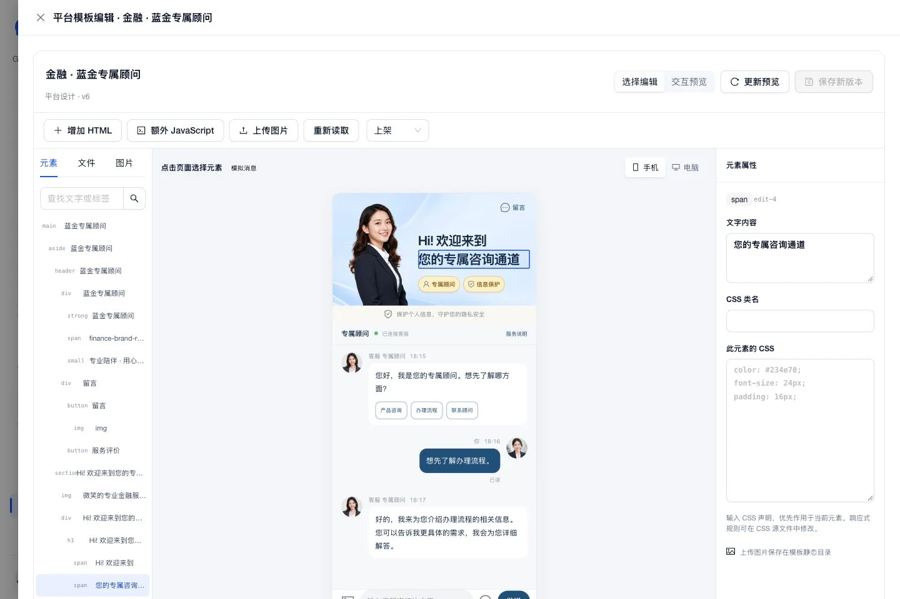

Source changes are saved as new immutable packages. Tenant page edits remain drafts until explicitly published. Consultation links can follow a published page or use a fixed release, and deletion checks references before reclaiming files that are no longer used. Platform-library revisions are versioned separately and preserve existing tenant copies.

## 10. AI-assisted template design

The administrator's AI assistant supports reference images, saved conversations, successive design changes and remixing an existing template. Its side-by-side preview uses simulated messages so a design can be inspected before publishing.

Tenants and the platform maintain separate model settings. Text/vision and image-generation models can be configured independently through compatible APIs. Server-side handling validates the returned text-or-file JSON, keeps image generation as a controlled step and rejects generated replacements for protected chat scripts. Keys are stored encrypted and are not returned as plaintext through the settings API.

Platform administrators can version the system prompt and official core scripts in separate foundation settings. Existing packages retain their original script snapshot; ordinary template editing and AI output cannot rewrite it.

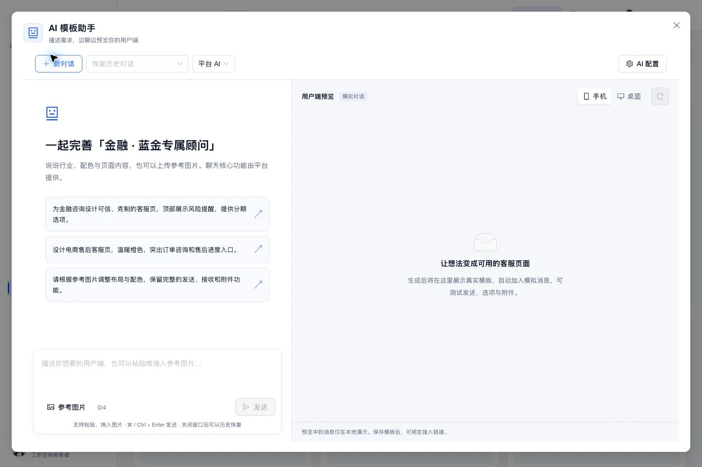

*A new design conversation before any template has been generated.*

The current AI feature is **template design assistance**. It is not an autonomous visitor-support chatbot or an unrestricted business agent. Calls depend on a configured provider, model access and the applicable usage limits; being listed in a provider's model catalog does not itself grant permission to use that model.

## 11. Tenant settings, callbacks and operational controls

Tenant settings bring reception policy, history behavior, notification preferences and related service controls into the workspace. Optional capabilities remain subject to both permissions and plan entitlements.

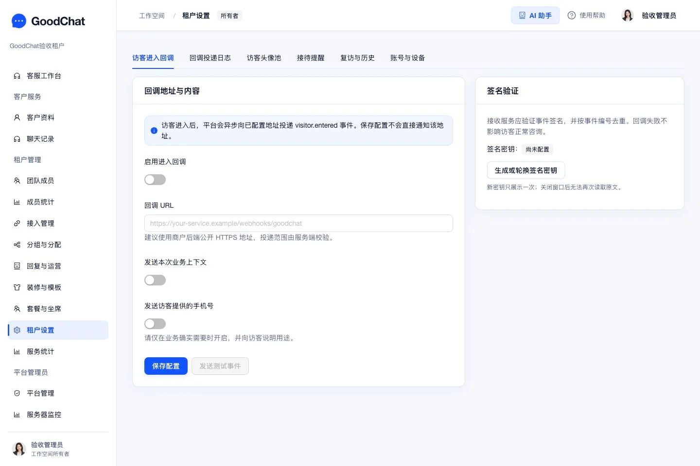

Visitor-entry callbacks can connect an entry event to a team's external system. They are delivered asynchronously with stable event IDs, HMAC-SHA256 signatures, delivery logs and retry controls. The receiving system should validate signatures and deduplicate event IDs.

## 12. Platform administration and plans

Platform administrators have a separate operational view for tenants, published templates, plan definitions and upgrade requests. The platform overview summarizes recorded activity across the platform without replacing tenant-level authorization.

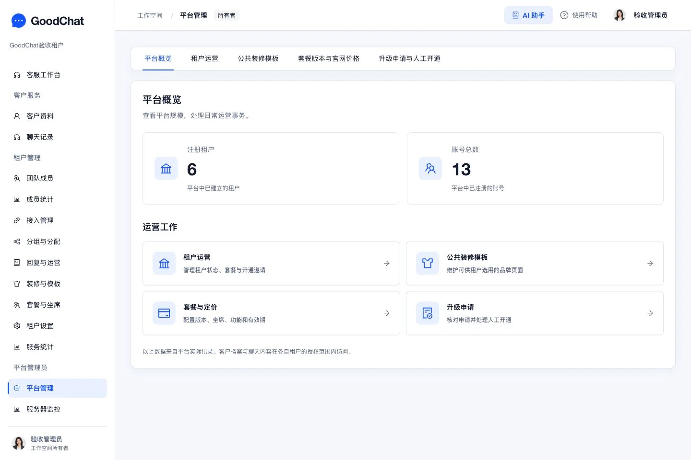

Plan definitions control seats, validity and feature entitlements. The protected free plan provides two seats with no expiry. Upgrade requests and manual activation are implemented; this module does not process online payments or provide a payment gateway.

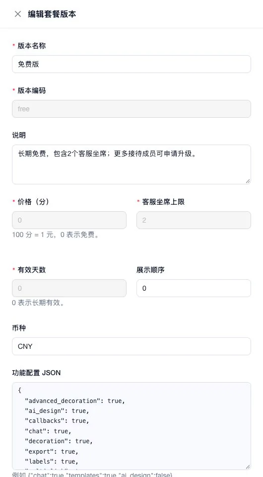

## 13. Server and reception monitoring

The platform monitor shows measured application or control-group resource information, database pool health, live connection counts and reception-capacity summaries. Its scope is identified in the interface; a container's measurements should not be read as an uninstrumented physical host's total capacity.

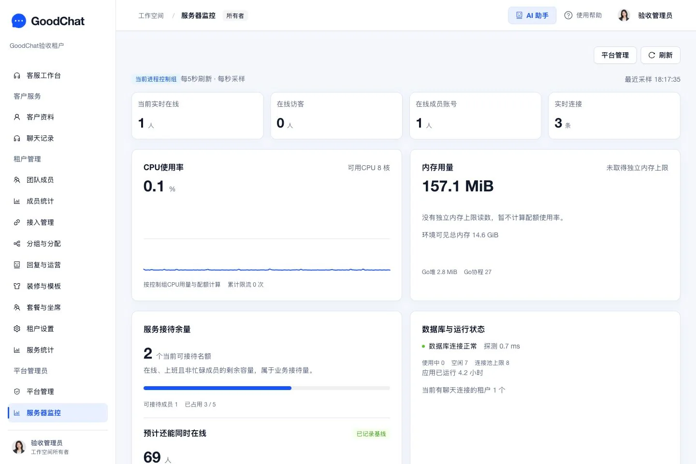

*The 100-user value is a manually entered demo baseline.*

Capacity estimates require a configured measurement baseline. They are not a promise that any deployment can support a fixed number of concurrent users.

## Architecture and delivery scope

- **Backend:** Go, PostgreSQL, Redis and durable message/event data.
- **Web interface:** Next.js, React, TypeScript and Ant Design.
- **Visitor customization:** Static HTML/CSS/JavaScript packages rendered on an isolated origin.
- **Deployment:** A GoodChat application image, with PostgreSQL and Redis configured separately. Email verification and notifications need SMTP; AI providers are optional.
- **Access control:** Tenant-scoped authorization, business-table row-level security and distinct platform, administrative and agent responsibilities.

The current product is a browser-based live chat and customer service SaaS. Native desktop/mobile clients, social-channel connectors and online payment integrations should not be inferred from the screenshots. The current real-time push implementation is single-instance; horizontal scaling needs shared event distribution. Production HTTPS, domain configuration, backups, provider permissions and target-browser testing remain deployment responsibilities.

[Back to GoodChat](../../README.md) · [Explore visitor templates](templates.md) · [简体中文](../zh-CN/features.md)
