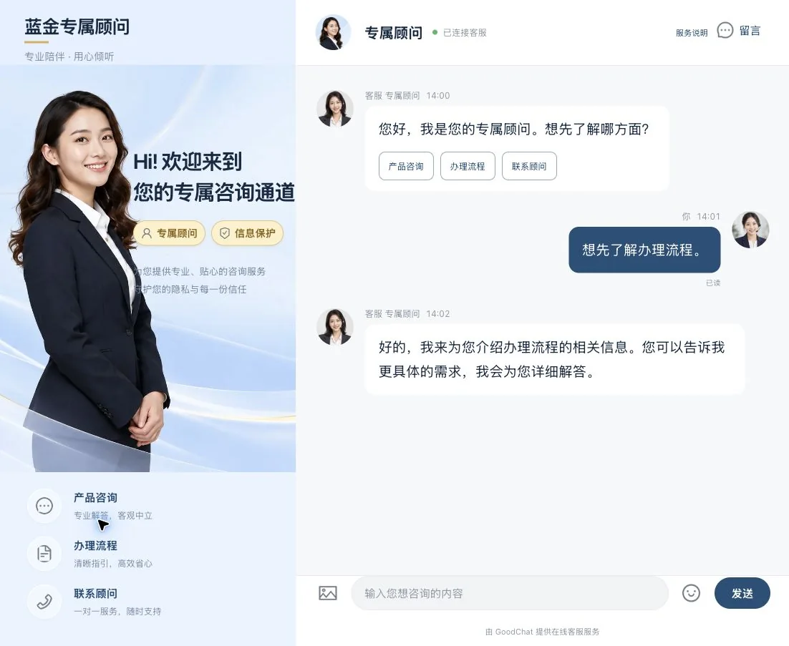
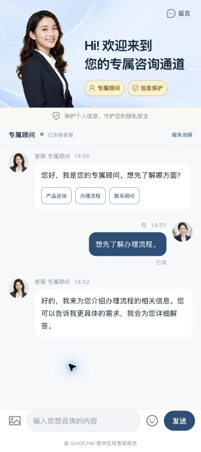
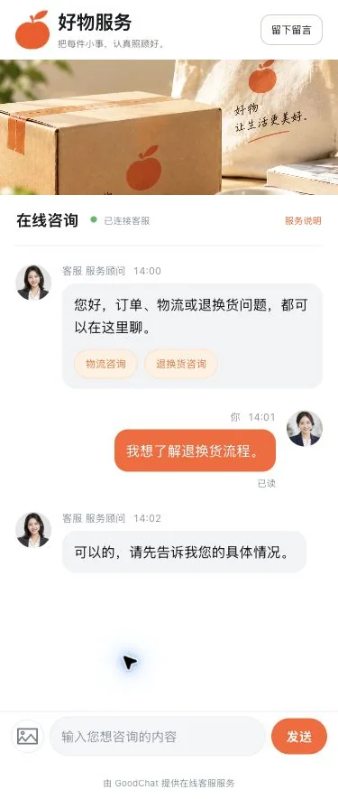
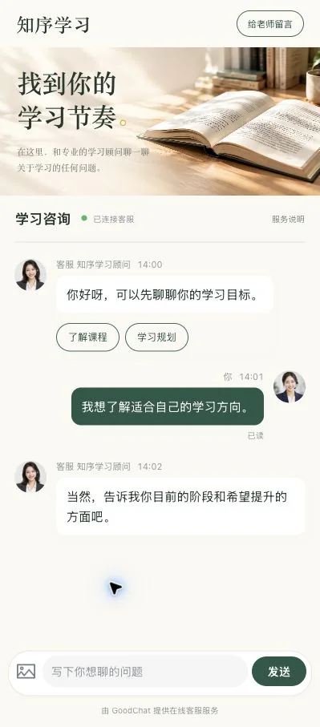
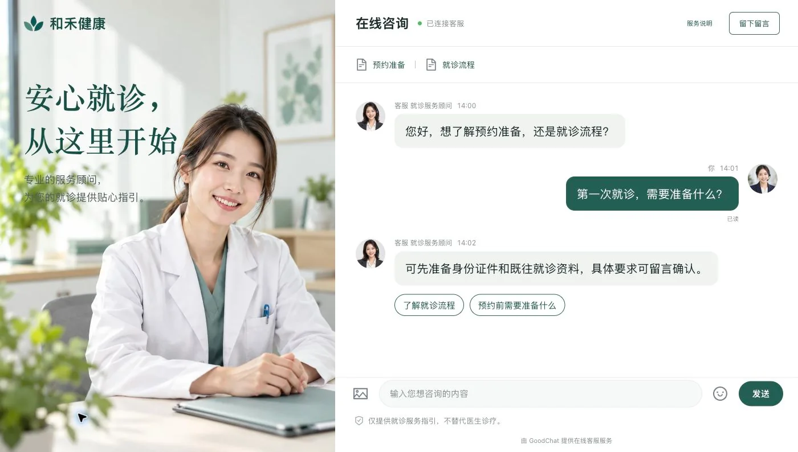
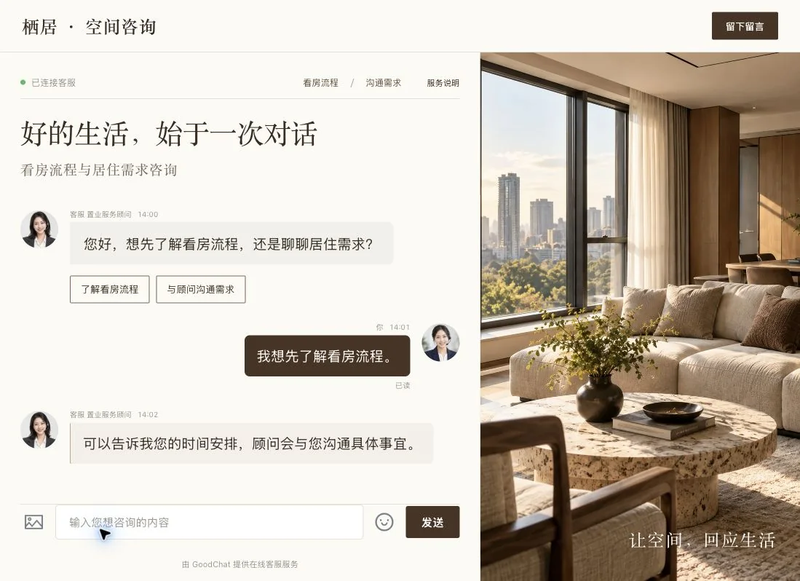
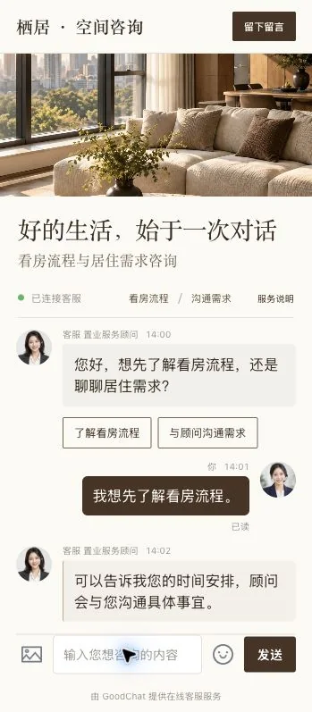
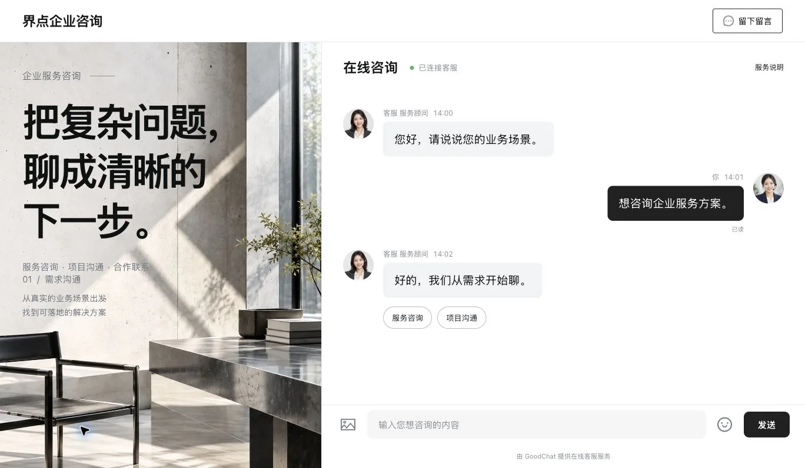
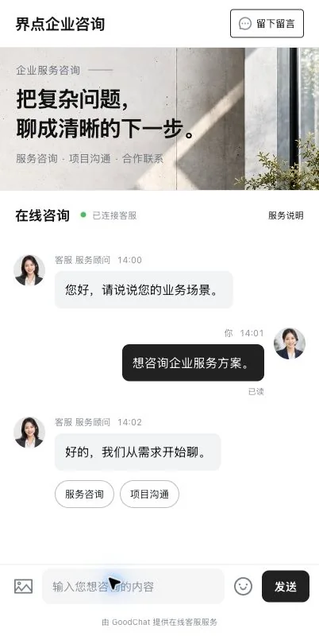

<!-- 文件作用说明：以真实截图介绍 GoodChat 七套响应式用户端模板及预览、点选编辑、静态文件、发布绑定和资源回收流程。 -->
# Visitor templates and visual editing

[English home](../../README.md) · [中文首页](../../README.zh-CN.md) · [简体中文](../zh-CN/templates.md) · [Official website](https://goodchat.58it.cn)

GoodChat provides responsive live chat templates for finance, ecommerce, education, healthcare service guidance, property, business consulting, and esports. Each template is a plain HTML, CSS, JavaScript, and static-asset package. A visitor template needs no second build step. Its presentation can change while messaging, WebSocket communication, attachments, leave-message forms, and other service actions continue through the official GoodChat core.

The gallery below contains **actual local browser screenshots**, showing Chinese UI and demonstration conversations. The templates were implemented from the approved designs; these images are not design mockups. Desktop and mobile layouts are shown separately. Click an image to view its original dimensions.

## Seven industry styles

### Finance — a dedicated advisor

Powder blue, restrained gold accents, an advisor portrait, and a desktop photography sidebar. The mobile layout places the welcome banner above the conversation, with clear consultation choices and a privacy reminder.

| Desktop | Mobile |
| --- | --- |
|  |  |

### Ecommerce — warm after-sales support

Persimmon orange, product packaging photography, and a spacious chat area. Delivery and returns prompts give visitors an immediate starting point; the mobile layout keeps the brand story short and the conversation accessible.

| Desktop | Mobile |
| --- | --- |
|  |  |

### Education — a calm learning conversation

Warm paper tones, ink green, and a real book-and-desk photograph. The desktop page adds editorial question prompts beside the conversation; mobile retains a compact reading-inspired banner and learning choices.

| Desktop | Mobile |
| --- | --- |
|  |  |

### Healthcare service guidance — clear and reassuring

White and teal, a clinical setting, and a direct path to appointment preparation and visit-process questions. The template presents service guidance and retains a visible note that it does not replace a doctor's diagnosis.

| Desktop | Mobile |
| --- | --- |
|  |  |

### Property — an editorial space consultation

Warm cream, espresso-colored controls, serif headlines, and interior photography. Desktop uses an image-and-conversation split; mobile stacks the interior scene, headline, and viewing-process conversation.

| Desktop | Mobile |
| --- | --- |
|  |  |

### Business consulting — bold and focused

Concrete, monochrome typography, and large editorial text introduce the service. The open conversation area supports business-service and project inquiries without crowding the visitor with extra panels.

| Desktop | Mobile |
| --- | --- |
|  |  |

### Esports — dark with lime accents

Charcoal surfaces, lime highlights, and headset photography create a distinct esports identity. Desktop places the conversation beside the campaign image; mobile brings the image above the dark chat and high-contrast composer.

| Desktop | Mobile |
| --- | --- |
|  |  |

These industry packages provide visitor-facing consultation designs. Their industry labels do not add separate lending, order management, learning management, diagnosis, property transaction, or game-service backends.

## Preview and use a template

1. As a tenant owner or administrator, open **Templates** (`模板管理`, `/console/templates`). Preview a platform or industry template from its card, then check both desktop and mobile modes.
2. Choose **Add to my templates** (`添加到我的模板`) to create a private copy. **Copy and download** (`复制并下载`) also creates a tenant-owned copy before exporting it. Editing that copy does not overwrite the platform original.
3. In **My templates** (`我的模板`), choose **More → Edit template** (`更多 → 编辑模板`) to customize the static package.
4. After editing, choose **More → Create page** (`更多 → 创建页面`). The page is an independent copy, with its own draft and publication history.

Preview conversations use simulated messages. A preview is a way to inspect design and controls, not a published visitor entry or a real customer conversation.

## Select an element and edit it

Use **Select and edit** (`选择编辑`) to click an element in the preview, or select it in the element tree. The properties panel supports:

- Text on an individual text element; for a container, select the relevant child text node.
- CSS class names and CSS declarations for the selected element.
- Input placeholder text, image alternative text, and image replacement.
- Styling of runtime chat elements, including bubbles and controls. Simulated runtime messages are not written back into the authored HTML.

Switch to **Interactive preview** (`交互预览`) to try the controls. After source or property changes, use **Update preview** (`更新预览`) to validate and render the current draft. **Save draft** (`保存草稿`) saves a new package revision; the published page changes only after publication.

## HTML, CSS, JavaScript, and image assets

The source panel exposes the editable HTML, CSS, and additional UI JavaScript. **Add HTML** (`增加 HTML`) inserts a local markup fragment; **Extra JavaScript** (`额外 JavaScript`) opens `static/custom.js` for interactions such as an information modal. Responsive breakpoints belong in the CSS source.

A typical package contains:

```text
index.html
static/style.css
static/custom.js
static/…images…
static/goodchat/sdk.js        # official, protected
static/goodchat/chat-ui.js    # official, protected
goodchat-contract.json       # platform-written contract
```

Use **Upload image** (`上传图片`) to add a local asset, or select an `` element and choose **Upload and replace image** (`上传并替换图片`). The image becomes part of the template package when the draft is saved.

The editor checks type, size, and dimensions before deciding whether compression is needed. Small images are retained; oversized static images can be reduced, transparent PNGs retain transparency, and GIFs retain animation rather than silently becoming a single frame. The server also validates the actual image format and resource limits. Rejected files report an error so a smaller or supported image can be selected.

## Keep service actions on the official SDK

The editor and AI cannot overwrite the official SDK, chat UI, or contract files. The platform validates their imports, actual bytes, versions, hashes, and integrity attributes. Add local presentation interactions in ordinary template files; route service actions through the official SDK and its supported declarations.

For example, a leave-message button can be styled freely while calling the existing form:

```html
<!-- 文件作用说明：通过官方核心打开当前访客的留言表单。 -->
<button type="button" data-gc-action="leave-message">Leave a message</button>
```

The corresponding SDK method is `GoodChat.openLeaveMessage()` with no arguments. The trusted host supplies the current visitor context and submits the form. Templates should not implement their own WebSocket connections, identity handling, attachment transport, or message APIs. The platform-provided technical-support footer remains visible below the template.

Platform administrators can maintain official core and prompt configurations through versioned administration settings. That is separate from a tenant editing a template: tenant source files and AI outputs cannot replace the protected core.

## Download, edit locally, and import again

**Download** exports a complete ZIP with the entry HTML, CSS, additional JavaScript, images, official scripts, and package manifest. Keep the protected files intact when editing local presentation files. Importing the ZIP creates a new private package and runs the same contract validation; it does not silently overwrite the source template or an existing published release.

The built-in AI remix flow can also start from an existing template. It uses the current tenant's configured AI service, accepts reference images, and creates an independent result. The seven designs in this gallery were implemented manually from the approved design boards.

## Publish and bind a visitor link

Create or edit the independent page, preview it, and publish a release. In an access link's **Visitor template** (`用户端模板`) setting, select the published page and choose its update policy:

| Policy | Result |
| --- | --- |
| Fixed published release (`固定已发布版本`) | The entry keeps using the selected immutable release. |
| Follow future page publications (`跟随此页面之后的发布`) | The entry follows subsequent releases of that page. |
| No template selected | The entry uses GoodChat's existing default visitor page. |

Saving a template draft does not publish a page. Updating a source template also does not overwrite an already-created independent page. Clear the binding to return an entry to the default visitor page.

## Delete with reference checks

Open **More → References and deletion** (`更多 → 引用与删除`) to inspect linked entries, pages, and active generation tasks. Disabled links can still reference a template and must be switched or unbound too. The server rechecks references when deletion is requested.

Once deletion is allowed, GoodChat removes the template's unbound pages and history and reclaims its unreferenced package files and generated assets. Files still owned or referenced elsewhere are retained; deleting one private copy does not remove another tenant's template.

## Screenshot and verification notes

All 14 gallery images preserve the source screenshots' dimensions and are compressed as WebP. English and Chinese documentation share the same assets. The [asset manifest](../media/templates/manifest.json) records source paths, dimensions, sizes, SHA-256 digests, and compression ratios.

The repository records desktop and responsive-browser checks for all seven templates, including typing, simulated sending, leave-message controls, options, attachments, image entry points, editing, and ZIP round trips. See the [implementation and acceptance record](https://github.com/hhh0078/GoodChat/blob/dev/docs/2026-10-30%E4%B8%83%E5%A5%97%E8%A1%8C%E4%B8%9A%E6%A8%A1%E6%9D%BF%E4%B8%8E%E5%85%83%E7%B4%A0%E7%BC%96%E8%BE%91%E5%99%A8%E9%AA%8C%E6%94%B6.md) for the tested scope. These are local browser results; the screenshots do not represent a physical-phone or production deployment test.

[Back to English README](../../README.md) · [中文模板指南](../zh-CN/templates.md)
